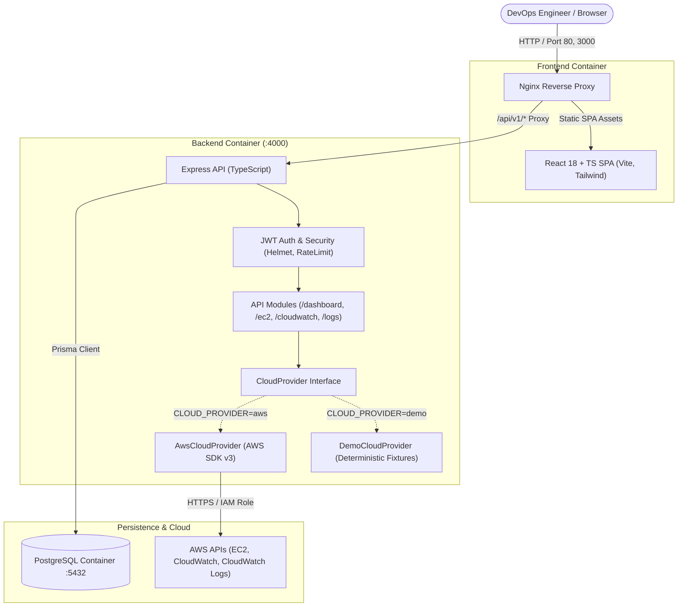

# Comprehensive Study Guide: CloudOps Command Center & AWS Infrastructure Automation

Welcome to the **CloudOps Command Center Study Guide**! This guide is crafted to provide a deep, step-by-step technical walkthrough of the architecture, codebase, cloud integrations, and DevOps patterns implemented in this project.

Whether you are preparing for **Cloud Engineer**, **DevOps Engineer**, or **Site Reliability Engineer (SRE)** technical interviews, or looking to master enterprise cloud dashboard design, this document covers every concept from fundamental principles to production nuances.

---

## Table of Contents
1. [Executive Summary: What Is CloudOps Command Center?](#1-executive-summary-what-is-cloudops-command-center)
2. [High-Level Architecture & Request Flow](#2-high-level-architecture--request-flow)
3. [Deep Dive into the CloudOps Provider Abstraction](#3-deep-dive-into-the-cloudops-provider-abstraction)
4. [Backend Architecture (Node.js, Express, TypeScript, Prisma)](#4-backend-architecture-nodejs-express-typescript-prisma)
   - [Domain Modular Structure](#domain-modular-structure)
   - [Authentication & JWT Security](#authentication--jwt-security)
   - [Database Layer: Prisma ORM & PostgreSQL](#database-layer-prisma-orm--postgresql)
   - [Structured Logging with Pino](#structured-logging-with-pino)
5. [Frontend Architecture (React 18, TypeScript, Tailwind, Recharts)](#5-frontend-architecture-react-18-typescript-tailwind-recharts)
   - [State Management with TanStack Query](#state-management-with-tanstack-query)
   - [Responsive Dark-Themed Operations Console](#responsive-dark-themed-operations-console)
   - [Telemetry Visualizations with Recharts](#telemetry-visualizations-with-recharts)
6. [AWS Services & Security Deep Dive](#6-aws-services--security-deep-dive)
   - [Amazon EC2 Fleet Telemetry](#amazon-ec2-fleet-telemetry)
   - [CloudWatch Metrics, Alarms, and Periods](#cloudwatch-metrics-alarms-and-periods)
   - [CloudWatch Logs & Bounded Filtering](#cloudwatch-logs--bounded-filtering)
   - [Least-Privilege Read-Only IAM Policy](#least-privilege-read-only-iam-policy)
7. [Containerization & Nginx Reverse Proxy](#7-containerization--nginx-reverse-proxy)
8. [Testing & Quality Gates](#8-testing--quality-gates)
9. [DevOps & Cloud Engineering Interview Questions & Answers](#9-devops--cloud-engineering-interview-questions--answers)

---

## 1. Executive Summary: What Is CloudOps Command Center?

### The Problem
Cloud and DevOps engineers often spend considerable time context-switching across different screens in the AWS Management Console during triage or incident response:
- Navigating to **EC2** to check instance states and private IPs.
- Navigating to **CloudWatch Metrics** to review CPU and network load curves.
- Navigating to **CloudWatch Alarms** to see which thresholds fired.
- Navigating to **CloudWatch Logs Insights** to fetch application logs.

### The Solution
**CloudOps Command Center** unifies these disparate operational views into a single, high-performance web dashboard:
- **Unified Overview**: Real-time fleet health (`HEALTHY`, `DEGRADED`, `CRITICAL`), active alarms, system reachability checks, and fleet-wide CPU/Network trends.
- **Compute Inventory**: Searchable and filterable EC2 table (by state, availability zone, IP, or tag) with an interactive telemetry drawer.
- **Monitoring & Alarms**: Real-time alarm status tracking with evaluation periods and trigger reasons.
- **Log Streaming**: Bounded, safe log streams with client-side keyword filtering.
- **Zero AWS Credential Leakage**: Completely isolated server-side architecture with zero cloud credentials exposed to client browsers.
- **Offline / Local Demo Capability**: Runs seamlessly in local demo mode using deterministic mock fixtures without requiring an active AWS account.

---

## 2. High-Level Architecture & Request Flow



### Trace of an API Request
1. **User Action**: The engineer visits the EC2 inventory page or opens an instance telemetry drawer.
2. **Client Request**: TanStack Query triggers a fetch to `/api/v1/ec2/instances/i-0a1b2c3d4e5f00001/metrics?metric=CPUUtilization&range=60`.
3. **Nginx Reverse Proxy**: Receives the request on port 80 and passes it internally to `backend:4000`.
4. **Auth & Validation**: Express verifies the Bearer JWT token in the `Authorization` header and validates request parameters using Zod.
5. **Provider Layer**: The controller asks `getCloudProvider().getInstanceMetrics(...)`.
   - In **Demo Mode**: `DemoCloudProvider` returns calculated, realistic sine/cosine telemetry curves.
   - In **AWS Mode**: `AwsCloudProvider` uses `@aws-sdk/client-cloudwatch`'s `GetMetricDataCommand` to query CloudWatch time-series data.
6. **Normalized Response**: The backend returns a normalized JSON response envelope (`{ data, meta }`), isolating the frontend from raw AWS SDK structures.
7. **Render**: The React UI updates the Recharts area chart smoothly with axes and tooltips.

---

## 3. Deep Dive into the CloudOps Provider Abstraction

A critical architectural pattern in this application is the **Provider Pattern**.

```typescript
// backend/src/providers/cloud-provider.ts
export interface CloudProvider {
  getAccountSummary(): Promise<DashboardSummary>;
  getDashboardTrends(): Promise<MetricTrendPoint[]>;
  getOperationalEvents(limit?: number): Promise<OperationalEvent[]>;
  listInstances(filters?: { state?: string; search?: string; az?: string }): Promise<EC2Instance[]>;
  getInstance(instanceId: string): Promise<EC2Instance | null>;
  getInstanceMetrics(instanceId: string, metricName: string, rangeMinutes?: number): Promise<InstanceMetrics>;
  listAlarms(filters?: { state?: string; search?: string }): Promise<CloudWatchAlarm[]>;
  getAlarm(alarmName: string): Promise<CloudWatchAlarm | null>;
  listConfiguredLogGroups(): Promise<LogGroup[]>;
  getLogEvents(logGroupName: string, startTime?: number, endTime?: number, limit?: number): Promise<LogEvent[]>;
}
```

### Why this design matters:
1. **Zero Cloud Cost for Local Development**: Developers can clone the repository and run all tests or the UI without an AWS account or credit card.
2. **Stable Automated Testing**: Unit and integration tests run deterministically against `DemoCloudProvider` without intermittent network failures or API throttling.
3. **Clean Decoupling**: Express route controllers depend strictly on domain interfaces (`CloudProvider`), not on concrete AWS SDK classes.

---

## 4. Backend Architecture (Node.js, Express, TypeScript, Prisma)

### Domain Modular Structure
```text
backend/src/
├── app.ts                 # Express initialization, security middleware & route mounting
├── server.ts              # Entrypoint listening on PORT
├── config/env.ts          # Zod-validated environment configuration
├── db/prisma.ts           # Prisma Client singleton
├── middleware/
│   ├── auth.ts            # JWT authentication middleware
│   └── error.ts           # Centralized structured error handler
├── modules/
│   ├── auth/              # Login, token issuance, session info
│   ├── dashboard/         # Aggregated KPIs, trend series, operational events
│   ├── ec2/               # Fleet listing, filtering, instance metrics
│   ├── cloudwatch/        # Alarm listing, details, filter states
│   ├── logs/              # Log groups and bounded event streams
│   └── settings/          # User preferences and refresh frequencies
├── providers/             # CloudProvider interface, Demo & AWS drivers
└── utils/logger.ts        # Pino structured logger
```

### Authentication & JWT Security
- **Password Storage**: Passwords are never stored in plaintext. They are salted and hashed using `bcryptjs` with 10 salt rounds.
- **JWT Verification**: Short-lived JSON Web Tokens are signed using `HS256` and verified on every protected route.
- **Brute-Force Protection**: `express-rate-limit` throttles repeated attempts to `/api/v1/auth/login` (max 20 requests per 15 minutes per IP).
- **Safe Fallback**: In offline demo mode where PostgreSQL might not be initialized, the backend securely accepts built-in demo credentials (`admin@cloudops.internal` / `Password123!`).

### Database Layer: Prisma ORM & PostgreSQL
Prisma schema defines three relational models:
- **`User`**: Account identity with unique email and password hash.
- **`UserPreference`**: Stores default AWS region and dashboard refresh intervals per user.
- **`AuditEvent`**: Tracks operational events (logins, seed events, state changes) with sanitized JSON metadata.

---

## 5. Frontend Architecture (React 18, TypeScript, Tailwind, Recharts)

### State Management with TanStack Query
- All server state is managed through TanStack Query (`@tanstack/react-query`).
- Configured with automatic background polling based on the user's selected interval (default 30–60s).
- Query keys are scoped (`['ec2-instances', stateFilter, search]`), ensuring fast client-side caching and instant re-renders when switching filters.

### Telemetry Visualizations with Recharts
- Area charts display 1-hour CPU utilization and Network In/Out bandwidth.
- Formatted tooltips render accurate units (`%`, `MB/s`, `Bytes/s`) and timestamps without interpolation.

---

## 6. AWS Services & Security Deep Dive

### Amazon EC2 Fleet Telemetry
- Uses `DescribeInstancesCommand` and `DescribeInstanceStatusCommand`.
- Normalizes instance states: `running`, `stopped`, `pending`, `stopping`, `terminated`.
- Extracts system reachability (`ok`, `impaired`, `not-applicable`).

### CloudWatch Metrics & Alarms
- Uses `GetMetricDataCommand` with 300-second periods.
- Queries standard EC2 metrics: `CPUUtilization`, `NetworkIn`, `NetworkOut`, `StatusCheckFailed`.
- Parses alarm states: `OK`, `ALARM`, `INSUFFICIENT_DATA`.

### Least-Privilege Read-Only IAM Policy
The application enforces least-privilege access. No write permissions (`ec2:Start*`, `ec2:Terminate*`) are granted:
```json
{
  "Version": "2012-10-17",
  "Statement": [
    {
      "Sid": "EC2Read",
      "Effect": "Allow",
      "Action": ["ec2:DescribeInstances", "ec2:DescribeInstanceStatus", "ec2:DescribeTags"],
      "Resource": "*"
    },
    {
      "Sid": "CloudWatchRead",
      "Effect": "Allow",
      "Action": ["cloudwatch:GetMetricData", "cloudwatch:ListMetrics", "cloudwatch:DescribeAlarms"],
      "Resource": "*"
    },
    {
      "Sid": "LogsRead",
      "Effect": "Allow",
      "Action": ["logs:DescribeLogGroups", "logs:FilterLogEvents"],
      "Resource": "arn:aws:logs:*:*:log-group:/aws/ec2/*:*"
    }
  ]
}
```

---

## 7. Containerization & Nginx Reverse Proxy

### Docker Architecture
- **Multi-Stage Backend Build**: `node:22-alpine` builder builds TypeScript with `tsc` and generates Prisma clients; the final lean runner image runs as a non-root `node` user.
- **Multi-Stage Frontend Build**: `node:22-alpine` builder compiles the React SPA via Vite; the final runner is `nginx:alpine` serving static assets and routing `/api/` upstream.
- **Docker Compose**: Orchestrates `postgres`, `backend`, and `frontend` with health checks and persistent volume storage.

---

## 8. Testing & Quality Gates

| Test Suite | Framework | Scope |
|---|---|---|
| **Backend API Tests** | Vitest + Supertest | Health check, login validation, JWT verification, EC2 inventory, alarms, logs |
| **Frontend UI Tests** | Vitest + React Testing Library | Login form rendering, credentials input, Overview KPI display |
| **Typecheck & Builds** | TypeScript (`tsc`) + Vite | Strict TypeScript compliance, bundle minification |
| **Container Build** | Docker Compose Build | Validates production container builds and non-root execution |

---

## 9. DevOps & Cloud Engineering Interview Questions & Answers

### Q1: Why do we use a backend provider abstraction instead of calling AWS directly from the React frontend?
**Answer:** Calling AWS directly from the browser would require exposing AWS IAM credentials or temporary STS credentials to client-side code, which is a major security risk. Furthermore, client-side calls would hit CORS limitations, rate limits, and expose raw cloud infrastructure topology. The backend acts as a secure, authenticated gateway that normalizes responses, enforces rate limits, sanitizes errors, and caches requests.

### Q2: How does the application handle offline local development without AWS credentials?
**Answer:** Through the `CloudProvider` interface and `DemoCloudProvider`. When `CLOUD_PROVIDER=demo` (the default), the backend serves deterministic fixtures representing realistic AWS resources (8 instances across multiple states and zones, 5 alarms, log streams, and CPU trend data) without making external network calls.

### Q3: What is the difference between CloudWatch Metric `Period` and `EvaluationPeriods` in alarms?
**Answer:** `Period` is the time interval (in seconds) over which metric datapoints are aggregated (e.g., 300 seconds for 5 minutes). `EvaluationPeriods` is the number of consecutive periods that must breach the configured threshold before the alarm transitions into the `ALARM` state.

### Q4: How does Nginx function in the containerized deployment?
**Answer:** Nginx acts as both a high-speed static file server for the compiled React SPA and a reverse proxy for API traffic. Requests starting with `/api/` are forwarded to the backend container (`http://backend:4000`), while all other routes fall back to `/index.html` to support client-side routing.

### Q5: What security measures prevent credential exposure or privilege escalation?
**Answer:**
1. **Least-Privilege IAM**: Read-only permissions with no mutation capabilities.
2. **Environment Isolation**: Secrets stored in `.env` (excluded by `.gitignore`).
3. **Rate Limiting & Helmet**: Protects against brute-force attacks and cross-site scripting (XSS).
4. **Sanitized Error Handling**: Internal stack traces and AWS SDK error payloads are stripped before returning HTTP error responses to clients.
