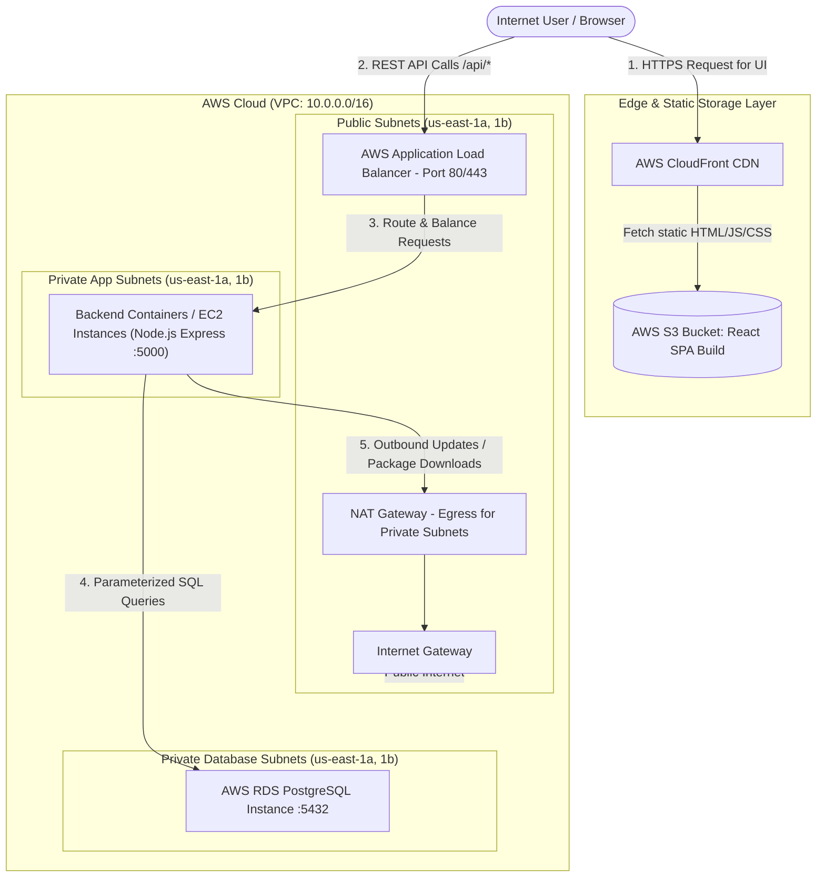
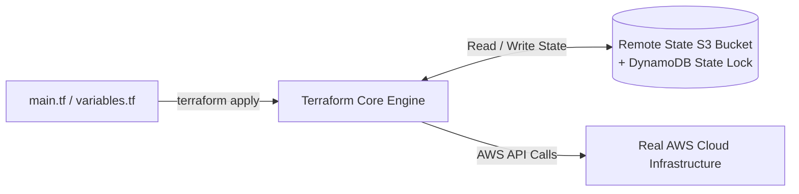
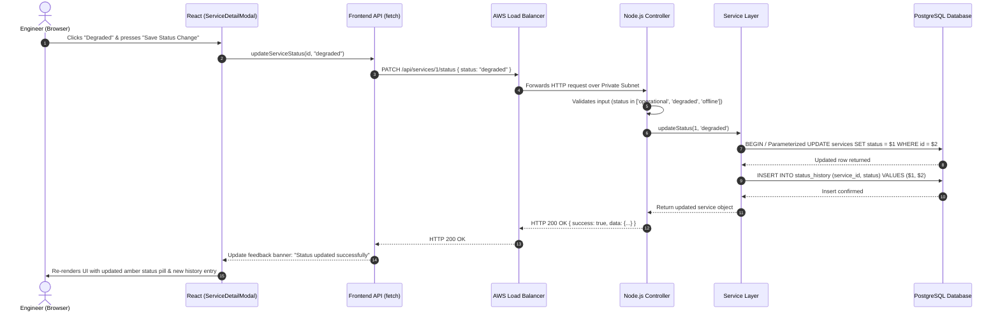

# Comprehensive Study Guide: CloudOps Status Dashboard & AWS Infrastructure

Welcome! This study guide is designed to take you **from the absolute basics to an advanced understanding** of the **CloudOps Status Dashboard** application and the corresponding **AWS Cloud Architecture & Terraform Infrastructure Automation** that supports it.

Whether you are preparing for DevOps engineering interviews, building out your personal portfolio, or learning how modern web applications and cloud architectures connect end-to-end, this document covers every concept step-by-step.

---

## Table of Contents
1. [Big Picture: What Is This Project?](#1-big-picture-what-is-this-project)
2. [End-to-End Architecture Overview](#2-end-to-end-architecture-overview)
3. [Deep Dive into AWS Services & Networking](#3-deep-dive-into-aws-services--networking)
   - [AWS VPC (Virtual Private Cloud) & Subnet Design](#aws-vpc-virtual-private-cloud--subnet-design)
   - [Internet Gateways, Route Tables, and NAT Gateways](#internet-gateways-route-tables-and-nat-gateways)
   - [AWS Security Groups vs. Network ACLs (NACLs)](#aws-security-groups-vs-network-acls-nacls)
   - [Compute Layer (EC2 / ECS / Fargate)](#compute-layer-ec2--ecs--fargate)
   - [Load Balancing (AWS Application Load Balancer - ALB)](#load-balancing-aws-application-load-balancer---alb)
   - [Relational Database Service (AWS RDS PostgreSQL)](#relational-database-service-aws-rds-postgresql)
   - [Static Frontend Hosting (AWS S3 & CloudFront CDN)](#static-frontend-hosting-aws-s3--cloudfront-cdn)
   - [DNS & Security (Route 53, ACM, AWS Secrets Manager)](#dns--security-route-53-acm-aws-secrets-manager)
4. [Infrastructure as Code (IaC) with Terraform](#4-infrastructure-as-code-iac-with-terraform)
   - [Why Terraform?](#why-terraform)
   - [How State Works (`terraform.tfstate`, S3 backend, DynamoDB locks)](#how-state-works)
   - [Terraform Module Architecture for this Project](#terraform-module-architecture-for-this-project)
5. [Deep Dive into the Application Codebase](#5-deep-dive-into-the-application-codebase)
   - [PostgreSQL Database Design & SQL Mechanics](#postgresql-database-design--sql-mechanics)
   - [Backend Architecture (Node.js & Express)](#backend-architecture-nodejs--express)
   - [Frontend Architecture (React 18 & Vite)](#frontend-architecture-react-18--vite)
   - [Testing Strategy (Vitest, RTL, Jest, Supertest)](#testing-strategy)
6. [Request Lifecycle: Step-by-Step Walkthrough](#6-request-lifecycle-step-by-step-walkthrough)
7. [Step-by-Step Hands-On Learning Path](#7-step-by-step-hands-on-learning-path)
8. [DevOps Interview Questions & Answers on this Project](#8-devops-interview-questions--answers-on-this-project)

---

## 1. Big Picture: What Is This Project?

### The Business Context
In any modern technology company or cloud ecosystem (Netflix, Uber, Amazon, Airbnb), high availability is paramount. When an incident occurs or a subsystem degrades, engineering teams and end-users need a centralized **Status Page** to understand:
- Is the database healthy?
- Is the API experiencing elevated latency or outages?
- What were the recent status transitions?

### Why this is a Standout Portfolio Project
Many beginner DevOps projects simply deploy an off-the-shelf "Hello World" container. This project is superior because:
1. **Real 3-Tier Web Application**: A React Single Page Application (frontend), an Express REST API (backend), and a PostgreSQL database (persistence).
2. **True Enterprise Cloud Isolation**: The database and backend are private and cannot be reached directly from the public internet.
3. **Automated Provisioning with Terraform**: Every piece of infrastructure is version-controlled and reproducible.
4. **Idempotent Operations**: The database migrations and seed scripts can run repeatedly without corrupting data or throwing duplicates.

---

## 2. End-to-End Architecture Overview

Below is the complete architectural layout showing how internet users access the frontend and API, and how traffic safely traverses AWS network boundaries:



---

## 3. Deep Dive into AWS Services & Networking

To master this architecture, you need to understand each AWS component from first principles.

### AWS VPC (Virtual Private Cloud) & Subnet Design
A **VPC** is your isolated private virtual data center inside AWS.
- **CIDR Block**: Typically assigned `10.0.0.0/16` (providing 65,536 private IP addresses).
- **Multi-AZ (Availability Zone) Design**: Enterprise applications run across at least two physical data centers (e.g., `us-east-1a` and `us-east-1b`) for fault tolerance.

#### The 3-Tier Subnet Strategy
We divide the VPC into three distinct tiers:
1. **Public Subnets (`10.0.1.0/24`, `10.0.2.0/24`)**:
   - Directly connected to an **Internet Gateway (IGW)**.
   - Hosts only public-facing resources: **Application Load Balancer (ALB)** and **NAT Gateways**.
   - **Never host your database or backend application code directly here.**
2. **Private Application Subnets (`10.0.10.0/24`, `10.0.11.0/24`)**:
   - No direct route to the Internet Gateway.
   - Hosts the Node.js Express backend servers (containers or EC2 instances).
   - Only reachable via the ALB.
   - Can access the internet *outbound* (e.g. for security patches or npm installs) through a **NAT Gateway**.
3. **Private Database Subnets (`10.0.20.0/24`, `10.0.21.0/24`)**:
   - Strictly isolated with **no outbound internet route** and **no public IPs**.
   - Contains RDS PostgreSQL instances and replicas.
   - Accessible *only* on port `5432` from the Private Application Subnets.

---

### Internet Gateways, Route Tables, and NAT Gateways

| Component | What It Does | Analogy |
| :--- | :--- | :--- |
| **Internet Gateway (IGW)** | A horizontally scaled VPC component that allows bidirectional communication between public resources and the internet. | The front door of an office building. |
| **Route Table** | A set of rules (routes) that determines where network traffic from your subnet is directed. | The hallway signs showing which door leads to which department. |
| **NAT Gateway** | Network Address Translation gateway located in a public subnet. Allows private backend servers to send outbound traffic to the internet while preventing external internet hosts from initiating inbound connections. | A one-way security turnstile. |

---

### AWS Security Groups vs. Network ACLs (NACLs)

In AWS, security operates in layers:

#### 1. Security Groups (Stateful Virtual Firewalls at the Instance/ENI Level)
- **Stateful**: If you allow incoming traffic on port 80, the return response traffic is automatically allowed regardless of outbound rules.
- **Principle of Least Privilege**:
  - **ALB Security Group**:
    - Inbound: `0.0.0.0/0` on Port `80` (HTTP) and `443` (HTTPS).
    - Outbound: Allow to Backend Security Group on Port `5000`.
  - **Backend Security Group**:
    - Inbound: ONLY from `ALB Security Group` on Port `5000`. (Blocks direct internet access!).
    - Outbound: Allow to RDS Security Group on Port `5432` + outbound internet via NAT.
  - **Database Security Group**:
    - Inbound: ONLY from `Backend Security Group` on Port `5432`.
    - Outbound: None (Database needs no egress).

#### 2. Network ACLs (Stateless Subnet-level Firewalls)
- Act as the perimeter boundary for entire subnets. Evaluated before security groups. Stateless means both inbound and outbound ports must be explicitly permitted (including ephemeral ports 1024–65535).

---

### Compute Layer (EC2 / ECS / Fargate)

In production, the Node.js Express backend is deployed in one of two main ways:
1. **AWS ECS (Elastic Container Service) with Fargate (Serverless Containers)**:
   - Eliminates the need to patch or manage virtual machines.
   - Scales container tasks automatically based on CPU or memory utilization.
   - Tasks register automatically with the Application Load Balancer Target Group.
2. **AWS EC2 Auto Scaling Group (ASG)**:
   - Deploys EC2 instances using a golden AMI or `user_data` script.
   - Automatically replaces unhealthy instances and scales up during traffic spikes.

---

### Load Balancing (AWS Application Load Balancer - ALB)
The ALB operates at **Layer 7 (Application Layer)** of the OSI model.
- **Listeners & Rules**:
  - Checks incoming HTTP/HTTPS requests.
  - Health checks: Continuously polls `GET /api/health` every 15–30 seconds.
  - If a backend instance fails health checks (returns anything other than `200 OK`), traffic is automatically routed only to healthy nodes.
- **SSL Termination**: Encrypts traffic from the internet using an SSL/TLS certificate managed by AWS Certificate Manager (ACM), while communicating over the private network to backends.

---

### Relational Database Service (AWS RDS PostgreSQL)
AWS RDS automates administrative database overhead:
- **Multi-AZ Deployment**: Maintains a synchronous standby replica in a second Availability Zone. If AZ 1 suffers an outage, RDS triggers automatic failover in under 60 seconds with no data loss.
- **Automated Snapshots & Point-In-Time Restore (PITR)**: Backs up write-ahead logs every 5 minutes, allowing you to restore to any second within your retention window.
- **Parameter Groups & Encryption**: Encrypts storage at rest using AWS KMS (Key Management Service).

---

### Static Frontend Hosting (AWS S3 & CloudFront CDN)
Rather than serving the React frontend from Node.js (which consumes expensive CPU and RAM on backend servers), modern DevOps utilizes **Jamstack / Static Site Architecture**:
1. Run `npm run build` inside `frontend/` to produce static assets (`dist/index.html`, JavaScript bundles, CSS).
2. Upload these assets to a private **AWS S3 Bucket**.
3. Point an **AWS CloudFront CDN (Content Delivery Network)** distribution to the S3 bucket using **Origin Access Control (OAC)**.
4. **Benefits**:
   - Ultra-low latency worldwide (cached at 400+ Edge Locations).
   - Near-zero hosting costs compared to running continuous server instances.
   - Virtually infinite scaling with built-in DDoS mitigation via AWS Shield.

---

## 4. Infrastructure as Code (IaC) with Terraform

### Why Terraform?
Instead of clicking through the AWS Web Console ("ClickOps"), Terraform allows you to define your entire cloud environment as declarative code.
- **Reproducibility**: Spin up identical `staging` and `production` environments with one command.
- **Version Control**: Every change to an IP address, security group rule, or RDS instance size is tracked in Git commits.

### How State Works
Terraform maintains a state file (`terraform.tfstate`) that maps your code declarations to the actual IDs of provisioned AWS resources.



- **Remote State in S3**: Stores the state file safely in an encrypted S3 bucket instead of on your local laptop.
- **State Locking via DynamoDB**: Prevents two team members or CI/CD pipelines from executing `terraform apply` at the same time, preventing state corruption.

### Terraform Module Architecture for this Project
When organizing Terraform for a real-world enterprise deployment of this application:

```text
terraform/
├── environments/
│   ├── dev/
│   │   ├── main.tf
│   │   ├── variables.tf
│   │   └── terraform.tfvars
│   └── prod/
│       ├── main.tf
│       └── terraform.tfvars
└── modules/
    ├── vpc/             # VPC, Subnets, IGW, NAT, Route Tables
    ├── security_groups/ # ALB, Backend, Database SG rules
    ├── rds/             # PostgreSQL Multi-AZ instance, Subnet Group
    ├── compute/         # ECS Fargate Service / EC2 Auto Scaling
    ├── alb/             # Load Balancer, Listeners, Target Groups
    └── frontend_s3/     # S3 Static Hosting, CloudFront, OAC
```

---

## 5. Deep Dive into the Application Codebase

Let's examine how each line of code in our application works and why it was designed this way.

### PostgreSQL Database Design & SQL Mechanics
Open [`backend/src/db/schema.sql`](file:///home/bhargav/personal/dev/devops/projects/Terraform%20AWS%20Infrastructure%20Automation/backend/src/db/schema.sql):

```sql
CREATE TABLE IF NOT EXISTS services (
    id SERIAL PRIMARY KEY,
    name VARCHAR(100) NOT NULL UNIQUE,
    description TEXT NOT NULL,
    status VARCHAR(20) NOT NULL CHECK (status IN ('operational', 'degraded', 'offline')),
    created_at TIMESTAMP WITH TIME ZONE DEFAULT CURRENT_TIMESTAMP,
    updated_at TIMESTAMP WITH TIME ZONE DEFAULT CURRENT_TIMESTAMP
);

CREATE TABLE IF NOT EXISTS status_history (
    id SERIAL PRIMARY KEY,
    service_id INTEGER NOT NULL REFERENCES services(id) ON DELETE CASCADE,
    status VARCHAR(20) NOT NULL CHECK (status IN ('operational', 'degraded', 'offline')),
    changed_at TIMESTAMP WITH TIME ZONE DEFAULT CURRENT_TIMESTAMP
);

CREATE INDEX IF NOT EXISTS idx_status_history_service_id ON status_history(service_id);
CREATE INDEX IF NOT EXISTS idx_status_history_changed_at ON status_history(changed_at DESC);
```

#### Key Engineering Decisions:
1. **CHECK Constraints**: `CHECK (status IN ('operational', 'degraded', 'offline'))` enforces data integrity at the database engine level. Even if a bug slipped through the API, invalid statuses cannot be inserted.
2. **Foreign Keys with `ON DELETE CASCADE`**: Linking `status_history.service_id` to `services.id` ensures that if a service is removed, its orphaned history records are cleaned up automatically.
3. **Database Indexing**:
   - `idx_status_history_service_id`: Makes retrieving history for a specific service (`WHERE service_id = $1`) lightning-fast ($O(\log N)$ instead of a full table scan $O(N)$).
   - `idx_status_history_changed_at`: Optimizes ordering by timestamp (`ORDER BY changed_at DESC`).
4. **Idempotent Seed Script** in [`backend/src/db/init.js`](file:///home/bhargav/personal/dev/devops/projects/Terraform%20AWS%20Infrastructure%20Automation/backend/src/db/init.js):
   - Uses `SELECT ... WHERE name = $1` before inserting. If the service already exists, it skips insertion. This enables running CI/CD deployment hooks repeatedly without generating duplicate rows.

---

### Backend Architecture (Node.js & Express)

The backend follows the **Controller-Service-Repository** pattern:

```text
HTTP Request
     │
     ▼
[routes/services.js]        <-- Defines URL paths and verbs
     │
     ▼
[controllers/serviceController.js] <-- Validates HTTP inputs, handles status codes
     │
     ▼
[services/serviceService.js]       <-- Executes business logic & parameterized SQL
     │
     ▼
[db/index.js]               <-- Manages pg.Pool connection to PostgreSQL
```

#### 1. Why Parameterized SQL Queries?
Notice in [`backend/src/services/serviceService.js`](file:///home/bhargav/personal/dev/devops/projects/Terraform%20AWS%20Infrastructure%20Automation/backend/src/services/serviceService.js):
```javascript
const result = await db.query(
  'SELECT id, name, description, status FROM services WHERE id = $1',
  [id]
);
```
**Never concatenate raw strings in SQL!** For example:
`db.query('SELECT * FROM services WHERE id = ' + id)` is vulnerable to **SQL Injection Attacks** where an attacker passes `1; DROP TABLE services; --`. Parameterized queries pass parameters through a separate protocol channel to the database driver, making SQL injection impossible.

#### 2. The Critical Health Check Endpoint
In [`backend/src/controllers/serviceController.js`](file:///home/bhargav/personal/dev/devops/projects/Terraform%20AWS%20Infrastructure%20Automation/backend/src/controllers/serviceController.js):
```javascript
exports.getHealth = (req, res) => {
  res.status(200).json({
    status: 'ok',
    timestamp: new Date().toISOString(),
    uptime: process.uptime(),
    service: 'cloudops-status-api',
  });
};
```
> [!IMPORTANT]
> The `/api/health` endpoint **must not query the database**. If your database temporarily restarts during a maintenance window, an ALB polling this health check would mark the backend containers as "unhealthy" and kill them all simultaneously (a cascading failure). The health check confirms that Node.js is alive and accepting connections.

---

### Frontend Architecture (React 18 & Vite)

The frontend is structured into modular, reusable components:
- **`App.jsx`**: Top-level application wrapper.
- **`Dashboard.jsx`**: State owner. Manages:
  - `services` (list of services fetched from the backend API)
  - `loading` and `error` states
  - `selectedServiceId` (controls modal display)
  - `fetchServicesData(isManualRefresh)` (refresh button handler)
- **`SummaryCards.jsx`**: Pure presentation component computing metrics on the fly (`operational`, `degraded`, `offline` counts).
- **`ServiceCard.jsx`**: Accessible card representation with hover states and keyboard navigation support (`Enter` / `Space` triggers details).
- **`ServiceDetailModal.jsx`**: Displays recent history records and provides the form to submit status updates via `PATCH /api/services/:id/status`.
- **`api.js`**: Centralized HTTP client using native `fetch` with error response extraction.

---

### Testing Strategy

Testing is what separates junior code from professional DevOps engineering:

1. **Backend Unit & Integration Testing (`backend/tests/services.test.js`)**:
   - Uses **Jest** and **Supertest** to simulate real HTTP requests without starting a physical TCP socket.
   - Mocks the `db` layer so test suites run in milliseconds and require no active database.
   - Tests happy paths (200 OK), validation errors (400 Bad Request), missing resources (404 Not Found), and database crashes (500 Internal Server Error).

2. **Frontend Component & Integration Testing (`frontend/src/tests/Dashboard.test.jsx`)**:
   - Uses **Vitest** and **React Testing Library (RTL)**.
   - Adheres to the testing philosophy: *"Test how users interact with your software, not implementation details."*
   - Simulates user clicks on cards, radio buttons, and submit buttons, verifying that the UI updates and API functions are called with correct arguments.

---

## 6. Request Lifecycle: Step-by-Step Walkthrough

Let's trace what happens when an engineer clicks **"Save Status Change"** to mark a service as `degraded`:



---

## 7. Step-by-Step Hands-On Learning Path

Follow these exercises to master this project yourself from scratch:

### Exercise 1: Run the App Locally
1. Start PostgreSQL locally:
   ```bash
   sudo systemctl start postgresql
   ```
2. Initialize database:
   ```bash
   createdb cloudops_status -U postgres
   cd backend
   npm run db:init
   ```
3. Run the backend:
   ```bash
   npm run dev
   ```
4. In another terminal, run the frontend:
   ```bash
   cd frontend
   npm run dev
   ```
5. Open `http://localhost:5173` in your browser. Open your browser DevTools Network tab and click through services to see the HTTP requests.

### Exercise 2: Explore the Database via CLI
Connect to your database:
```bash
psql -U postgres -d cloudops_status
```
Run queries:
```sql
SELECT * FROM services;
SELECT * FROM status_history ORDER BY changed_at DESC;
```
Now change a status in the web UI, re-run `SELECT * FROM status_history;` in `psql`, and watch the new timestamp entry appear.

### Exercise 3: Run the Test Suites
Run the backend tests:
```bash
cd backend && npm test
```
Run the frontend tests:
```bash
cd frontend && npm test
```
Try breaking a validation rule in `serviceController.js` (for example, remove `'degraded'` from `VALID_STATUSES`) and re-run `npm test` to observe how Jest detects the regression immediately.

---

## 8. DevOps Interview Questions & Answers on this Project

Use these sample questions to prepare for technical interviews:

### Q1: Why did you place the backend in private subnets instead of public subnets?
> **Answer**: Placing the backend in a private subnet enforces network defense-in-depth. Compute resources do not have public IP addresses and cannot be reached directly by automated scanners, botnets, or brute-force attacks on the open internet. All inbound traffic must pass through the Application Load Balancer, which can inspect requests, enforce SSL, and integrate with AWS WAF for DDoS and web attack mitigation.

### Q2: What is the difference between a Security Group and a Network ACL?
> **Answer**: 
> - **Security Groups** operate at the virtual network interface (instance) level and are **stateful**. Outbound responses to permitted inbound connections are automatically allowed.
> - **NACLs** operate at the subnet boundary and are **stateless**. Both inbound and outbound traffic must be explicitly permitted by rule number.

### Q3: Why didn't you serve the frontend bundle from the Express server?
> **Answer**: Decoupling frontend static assets from backend compute is a DevOps best practice. Serving static files via S3 and CloudFront CDN provides global edge caching, near-zero hosting costs, and infinite scalability without loading the Express Node.js event loop. The Express server remains dedicated to dynamic business logic and database queries.

### Q4: How does your database initialization avoid race conditions and duplicate seed records?
> **Answer**: The seed script checks for existing records by a unique constraint key (`name`) before executing an `INSERT`. This idempotent approach allows the migration script to run safely on every container start or deployment pipeline without throwing primary key collision errors or polluting data.

---

*This guide provides the foundational understanding required to design, implement, and discuss modern cloud-native architectures.*

